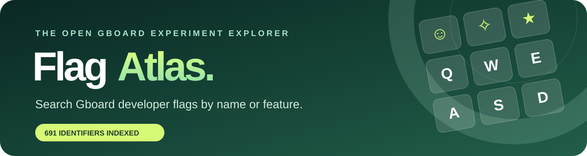

<div align="center">



<br>

**The independent, searchable field guide to Gboard developer experiments.**

<a href="https://gboard-flag-atlas.shipstatic.com"></a>
<a href="https://github.com/stupidgiraffe/gboard-flag-atlas/stargazers"></a>
<a href="LICENSE"></a>

<br><br>

[**🌐 Launch the Flag Atlas**](https://gboard-flag-atlas.shipstatic.com) · [**💡 Suggest a correction**](https://github.com/stupidgiraffe/gboard-flag-atlas/issues/new) · [**☕ Support the project**](https://buymeacoffee.com/stupidgiraffe)

</div>

---

## Your keyboard has hundreds of hidden experiments. Now they have a map.

Gboard's feature flags are a mixture of new UI, smart predictions, Emoji Kitchen experiments, voice technology, model gates, diagnostic settings, and low-level implementation switches. Some change your keyboard. Some do absolutely nothing on your version. Others are not really toggles at all.

**Gboard Flag Atlas makes them approachable** without pretending every undocumented identifier has a known effect.

<table>
<tr><td width="33%">🔎 <b>Search everything</b><br><sub>Find exact identifiers or search in plain English.</sub></td><td width="33%">🧭 <b>Filter by purpose</b><br><sub>Ten categories, from Emoji Kitchen and AI to internal plumbing.</sub></td><td width="33%">🧪 <b>Understand uncertainty</b><br><sub>Clearly distinguish interpreted flags from name-derived guesses.</sub></td></tr>
<tr><td>⭐ <b>Save favorites</b><br><sub>Build a shortlist in your browser—no account required.</sub></td><td>📋 <b>Copy in one tap</b><br><sub>Paste the exact identifier into GboardWu's flag editor.</sub></td><td>🔐 <b>Static and private</b><br><sub>No tracking, analytics, backend or server-side accounts.</sub></td></tr>
</table>

### [→ Explore the live catalog](https://gboard-flag-atlas.shipstatic.com)

The current snapshot indexes **691 flag-like identifiers extracted from GboardWu 18.5.4.993608717**. Every entry has been rewritten for clarity; after two research passes on all 92 initially unresolved entries, 71 now have useful explanations and just 21 remain explicitly marked **Unknown**. Public source references are linked for 70 entries overall; research-backed references are distinct from runtime verification. An identifier alone is never proof of a working toggle.

**All identifiers are included**, including the esoteric, potentially useless, and implementation-only ones. Nothing is hidden merely because it is unlikely to interest casual users.

## What's inside?

| Explore | Scope |
|---|---|
| 😀 Emoji & expression | Emoji Kitchen, sticker predictions, GIFs, Emojify |
| ✍️ Predictions & corrections | Smart suggestions, autocorrection, next-word models |
| ✨ AI & writing tools | Rewrite, proofreading, on-device AI, model integration |
| 🎙️ Voice & dictation | Speech recognition, commands, multilingual input |
| 🪄 Toolbar & editing | Cursor actions, suggestion strip, contextual toolbar |
| 🎨 Themes & layout | Visual effects, transitions, key shapes, floating mode |
| 🌐 Languages & accessibility | Input methods, language support, assistive features |
| 🛡️ Privacy & diagnostics | Logging, tracing, metrics, potentially sensitive data |
| ⚙️ Technical / other | Experiments and compatibility controls |
| 🗃️ Internal & low-value | Stored preferences, counters and other plumbing |

### How to use a flag

1. Open the [atlas](https://gboard-flag-atlas.shipstatic.com), search a feature, and copy the exact identifier.
2. In a compatible patched Gboard, open **Patches → More settings → Developer options → Flag Editor**.
3. Search by name. **Verify that the entry actually exists and read its type/default before editing.**
4. Change one thing at a time. Restart Gboard only if required, and keep track of what you changed.

> [!IMPORTANT]
> **Catalog ≠ a list of confirmed working switches.** APK strings can represent stored preferences, runtime conditions, counters, configuration parameters and experimental flags. Presence does not establish editability, current default, availability, security or impact. Google-side rollout and device eligibility can override local settings. Do not force flags blindly or assume a battery-impact label is measured data.

## How trustworthy are the entries?

| Label | Meaning |
|---|---|
| **Interpreted** | More specific explanation based on naming, context or known behavior; **not** independently verified in every runtime. |
| **Name-derived** | A carefully edited interpretation based on the identifier; behavior not independently checked. |
| **Code-referenced** | A matching flag or related implementation was found in public source; this does not establish runtime support. |
| **Community-referenced** | A mod developer or technical investigation describes the feature; outcomes depend on build and eligibility. |
| **Library-referenced** | The identifier maps to platform or networking library code, not necessarily a Gboard feature. |
| **Unknown** | Reviewed, but reliable behavior couldn't be established; shown with a distinct amber badge. |
| **Explore / Optional / Low priority** | Editorial navigation, **not** a safety guarantee or evidence of feature support. |

We want documentation supported by source code, logs, UI behavior, experimental results and build/version information. Corrections are welcome—especially when a flag's meaning changes across Gboard releases.

## Data and architecture

```text
index.html                 Beautiful standalone static interface
data/
  flags.json               Browseable annotations + confidence/risk metadata
  flag-identifiers.json    Raw anonymized candidate identifiers from APK strings
assets/
  coffee-qr.svg            QR code for supporting maintenance
  icon.svg                 Site icon
docs/
  banner.svg               GitHub/project branding
.github/FUNDING.yml        GitHub sponsorship link
```

No React build pipeline, cookies, server API, database or user account is required. Favorites are stored locally in the browser using `localStorage` and can be exported as plain text. ShipStatic hosts the public site; GitHub is the source of truth.

Future version snapshots and community-tested defaults can be added without changing the front-end architecture.

### Sources and attribution

- **[Gboard-patches by jasonwu1994](https://github.com/jasonwu1994/Gboard-patches)** — the independent patched Gboard project that exposes Developer options and a Flag Editor.
- **Gboard and Emoji Kitchen** are Google products and trademarks. This atlas is independent and **not affiliated with, endorsed by, or maintained by Google or Gboard-patches**.
- The catalog is compiled from static feature identifiers and our own annotations. It does **not** distribute modified APKs, extracted proprietary code, private device preferences, or user content.

## Contribute

Found a missing flag, a wrong description, a version-specific default, or reproducible proof of an effect?

[**Open an issue**](https://github.com/stupidgiraffe/gboard-flag-atlas/issues/new) with the exact flag name, Gboard build/version, observed behavior, device/OS as relevant, and steps to reproduce. Please **do not share private typing data, clipboard content, log tokens, or account information.**

Read [CONTRIBUTING.md](CONTRIBUTING.md) for the straightforward workflow.

## Support development ☕

Maintaining a clear, accurate catalog of fast-moving experiments takes ongoing research. If you find this project useful, a coffee helps.

<p align="center">
<a href="https://buymeacoffee.com/stupidgiraffe"></a><br>
<a href="https://buymeacoffee.com/stupidgiraffe"><b>☕ Buy me a coffee</b></a><br>
<sub>Scan the QR code or use the link. Completely optional.</sub>
</p>

---

<div align="center">
<sub>Made for curious keyboard tinkerers. Contribute what you can verify. Leave the guesswork labeled.</sub><br>
<sub>Site source: MIT · Original catalog annotations: CC BY 4.0 · © 2026 stupidgiraffe</sub>
</div>
