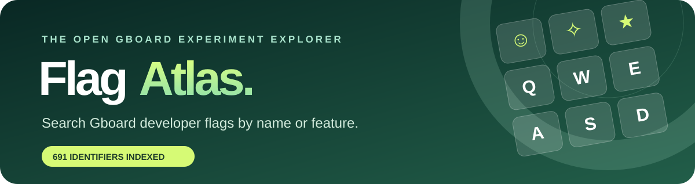

<div align="center">



<br>

**The independent, searchable field guide to Gboard developer experiments.**

<a href="https://gboard-flag-atlas.shipstatic.com"></a>
<a href="https://github.com/stupidgiraffe/gboard-flag-atlas/stargazers"></a>
<a href="LICENSE"></a>

<br><br>

[**🌐 Launch the Flag Atlas**](https://gboard-flag-atlas.shipstatic.com) · [**💡 Suggest a correction**](https://github.com/stupidgiraffe/gboard-flag-atlas/issues/new) · [**☕ Support the project**](https://buymeacoffee.com/stupidgiraffe)

</div>

---

## Your keyboard has hundreds of hidden experiments. Now they have a map.

Gboard's feature flags are a mixture of new UI, smart predictions, Emoji Kitchen experiments, voice technology, model gates, diagnostic settings, and low-level implementation switches. Some change your keyboard. Some do absolutely nothing on your version. Others are not really toggles at all.

**Gboard Flag Atlas makes them approachable** without pretending every undocumented identifier has a known effect.

<table>
<tr><td width="33%">🔎 <b>Search everything</b><br><sub>Find exact identifiers or search in plain English.</sub></td><td width="33%">🧭 <b>Filter by purpose</b><br><sub>Ten categories, from Emoji Kitchen and AI to internal plumbing.</sub></td><td width="33%">🧪 <b>Understand uncertainty</b><br><sub>Clearly distinguish interpreted flags from name-derived guesses.</sub></td></tr>
<tr><td>⭐ <b>Save favorites</b><br><sub>Build a shortlist in your browser—no account required.</sub></td><td>📋 <b>Copy in one tap</b><br><sub>Paste the exact identifier into GboardWu's flag editor.</sub></td><td>🔐 <b>Static and private</b><br><sub>No account or backend; privacy-friendly Cloudflare Web Analytics.</sub></td></tr>
</table>

### [→ Explore the live catalog](https://gboard-flag-atlas.shipstatic.com)

The current snapshot indexes **691 flag-like identifiers extracted from GboardWu 18.5.4.993608717**. Every entry has been rewritten for clarity; after two research passes on all 92 initially unresolved entries, 75 now have useful explanations and 17 remain explicitly marked **Unknown**. Public source references are linked for 70 entries overall; research-backed references are distinct from runtime verification. An identifier alone is never proof of a working toggle.

**All identifiers are included**, including the esoteric, potentially useless, and implementation-only ones. Nothing is hidden merely because it is unlikely to interest casual users.

## What's inside?

| Explore | Scope |
|---|---|
| 😀 Emoji & expression | Emoji Kitchen, sticker predictions, GIFs, Emojify |
| ✍️ Predictions & corrections | Smart suggestions, autocorrection, next-word models |
| ✨ AI & writing tools | Rewrite, proofreading, on-device AI, model integration |
| 🎙️ Voice & dictation | Speech recognition, commands, multilingual input |
| 🪄 Toolbar & editing | Cursor actions, suggestion strip, contextual toolbar |
| 🎨 Themes & layout | Visual effects, transitions, key shapes, floating mode |
| 🌐 Languages & accessibility | Input methods, language support, assistive features |
| 🛡️ Privacy & diagnostics | Logging, tracing, metrics, potentially sensitive data |
| ⚙️ Technical / other | Experiments and compatibility controls |
| 🗃️ Internal & low-value | Stored preferences, counters and other plumbing |

### How to use a flag

1. Open the [atlas](https://gboard-flag-atlas.shipstatic.com), search a feature, and copy the exact identifier.
2. In a compatible patched Gboard, open **Patches → More settings → Developer options → Flag Editor**.
3. Search by name. **Verify that the entry actually exists and read its type/default before editing.**
4. Change one thing at a time. Restart Gboard only if required, and keep track of what you changed.

> [!IMPORTANT]
> **Catalog ≠ a list of confirmed working switches.** APK strings can represent stored preferences, runtime conditions, counters, configuration parameters and experimental flags. Presence does not establish editability, current default, availability, security or impact. Google-side rollout and device eligibility can override local settings. Do not force flags blindly or assume a battery-impact label is measured data.

## How trustworthy are the entries?

| Label | Meaning |
|---|---|
| **Interpreted** | More specific explanation based on naming, context or known behavior; **not** independently verified in every runtime. |
| **Name-derived** | A carefully edited interpretation based on the identifier; behavior not independently checked. |
| **Code-referenced** | A matching flag or related implementation was found in public source; this does not establish runtime support. |
| **Community-referenced** | A mod developer or technical investigation describes the feature; outcomes depend on build and eligibility. |
| **Library-referenced** | The identifier maps to platform or networking library code, not necessarily a Gboard feature. |
| **Unknown** | Reviewed, but reliable behavior couldn't be established; shown with a distinct amber badge. |
| **Explore / Optional / Low priority** | Editorial navigation, **not** a safety guarantee or evidence of feature support. |

We want documentation supported by source code, logs, UI behavior, experimental results and build/version information. Corrections are welcome—especially when a flag's meaning changes across Gboard releases.

## Data and architecture

```text
index.html                 Responsive static search interface
assets/flag-search.mjs     Exact-token, synonym and relevance ranking
assets/vendor/              Locally hosted Fuse.js 7.5.0 and license
data/
  flags.json               Browseable annotations + confidence/risk metadata
  flag-identifiers.json    Raw anonymized candidate identifiers from APK strings
assets/
  coffee-qr.svg            QR code for supporting maintenance
  icon.svg                 Site icon
docs/
  banner.svg               GitHub/project branding
.github/FUNDING.yml        GitHub sponsorship link
```

No React build pipeline, cookies, server API, database or user account is required. Search uses locally hosted Fuse.js 7.5.0 (Apache-2.0) for typo tolerance plus exact-token/acronym ranking, and is disabled for misleading two-letter fuzzy matches. Favorites are stored locally in the browser using `localStorage` and can be exported as plain text. ShipStatic hosts the public site; GitHub is the source of truth.

Future version snapshots and community-tested defaults can be added without changing the front-end architecture.

### Sources and attribution

- **[Gboard-patches by jasonwu1994](https://github.com/jasonwu1994/Gboard-patches)** — the independent patched Gboard project that exposes Developer options and a Flag Editor.
- **Gboard and Emoji Kitchen** are Google products and trademarks. This atlas is independent and **not affiliated with, endorsed by, or maintained by Google or Gboard-patches**.
- The catalog is compiled from static feature identifiers and our own annotations. It does **not** distribute modified APKs, extracted proprietary code, private device preferences, or user content.

## Contribute

Found a missing flag, a wrong description, a version-specific default, or reproducible proof of an effect?

[**Open an issue**](https://github.com/stupidgiraffe/gboard-flag-atlas/issues/new) with the exact flag name, Gboard build/version, observed behavior, device/OS as relevant, and steps to reproduce. Please **do not share private typing data, clipboard content, log tokens, or account information.**

Read [CONTRIBUTING.md](CONTRIBUTING.md) for the straightforward workflow.

## Support development ☕

Maintaining a clear, accurate catalog of fast-moving experiments takes ongoing research. If you find this project useful, a coffee helps.

<p align="center">
<a href="https://buymeacoffee.com/stupidgiraffe"></a><br>
<a href="https://buymeacoffee.com/stupidgiraffe"><b>☕ Buy me a coffee</b></a><br>
<sub>Scan the QR code or use the link. Completely optional.</sub>
</p>

---

<div align="center">
<sub>Made for curious keyboard tinkerers. Contribute what you can verify. Leave the guesswork labeled.</sub><br>
<sub>Site source: MIT · Original catalog annotations: CC BY 4.0 · © 2026 stupidgiraffe</sub>
</div>

### Search regression tests

Run `node tests/search.test.mjs` to verify short acronyms, exact flag ranking, typo tolerance and empty results. The vendored Fuse.js 7.5.0 distribution is Apache-2.0 licensed (license included in `assets/vendor/`).


## Analytics and search discovery

Cloudflare Web Analytics measures privacy-friendly site traffic via the public Cloudflare beacon on the Atlas homepage and flag/topic/guide pages. Traffic is visible under **Cloudflare Dashboard → Web Analytics → gboard-flag-atlas.shipstatic.com**; there is no login, cookie, or local database on this site.

To keep the catalog useful rather than generate hundreds of thin SEO pages, only **159 specifically interpreted or source-linked flag entries** have individual indexable HTML pages under `/flags/<identifier>/`. The remaining 532 name-only or unresolved identifiers remain available in the full Atlas and can be shared via `/?flag=<identifier>`. Ten topic hubs under `/topics/` provide crawlable internal links, alongside **20 original, user-focused technical guides**, an index at `/guides/`, `sitemap.xml` (191 URLs) and `robots.txt`. A sitemap aids discovery but does not guarantee ranking or indexing.

Static pages, topic hubs, the homepage assets and the sitemap are reproducibly generated from `data/flags.json` by:

```sh
node scripts/build-site.mjs
node tests/site-build.test.mjs
node tests/search.test.mjs
```

The generator writes a complete ShipStatic-ready `dist/` directory. After changing any flag description, rebuild and include the new generated pages in a deployment. Analytics is domain-scoped to the production ShipStatic hostname; a new custom domain would require updating the Cloudflare Web Analytics registration and beacon.

## Technical guides

20 editorial guides in `data/guides.json` cover flag editor workflows, reproducible verification, autocorrection/key correction, User Feature Cache, KLP bytecode analysis, multilingual typing, voice dictation, model downloads, AI writing, grammar checking, Emoji Kitchen, stickers, layout, clipboard, privacy, and performance troubleshooting. Each guide provides original explanations, cautious evidence claims, named flag cross-links, FAQs and relevant references. The generator outputs `/guides/` and 20 canonical `/guides/<topic>/` pages; guide metadata and content are version-controlled. Google indexing is not guaranteed. These pages are written to answer user questions rather than mass-produce near-duplicate SEO text.

## Free automatic Gboard version tracking

GitHub Actions runs [the upstream watcher](.github/workflows/track-gboard-versions.yml) once per day (06:17 UTC), with manual runs available in Actions. It records observed versions and a bounded history in [data/upstream-versions.json](data/upstream-versions.json), and opens a GitHub issue when a newer/different Gboard version is observed. The two independent metadata signals are the [Gboard Patches compatibility manifest](https://github.com/jasonwu1994/Gboard-patches/blob/main/patches-list.json) and APKMirror's public [Gboard versions page](https://www.apkmirror.com/apk/google-inc/gboard/versions/). APKMirror parsing is best-effort, and upstream availability can delay or prevent a detection. The watcher never downloads APK binaries, modifies a user's device, or silently changes the Atlas catalog.

**Version detection is not flag detection.** An added, removed, or changed flag can only be confirmed by analyzing a new relevant Gboard APK. Once a fresh candidate-identifier snapshot has been acquired in the same JSON shape as `data/flag-identifiers.json`, run `node scripts/diff-flag-snapshots.mjs new-snapshot.json` to compare it with the existing 691-candidate baseline. Review findings manually before updating catalog annotations. Never redistribute copyrighted APKs or upload personal flag-store values.

To verify the tracker logic locally, run `node --test tests/upstream-tracker.test.mjs tests/flag-version-diff.test.mjs`. The free public-repository workflow may be automatically disabled after 60 days of repository inactivity, per GitHub's schedule policy.

### Hands-free APK flag discovery (experimental)

The separate [APK snapshot workflow](.github/workflows/scan-gboard-apks.yml) follows the daily version watcher and tries to acquire a matching Google Gboard stable and beta package automatically. It uses [justapk 0.1.1](https://github.com/TheQmaks/justapk) with multiple public-mirror fallback sources, inspects the Android package and version through Androguard, and extracts only candidate identifiers from DEX string tables. APK/APKM/XAPK files are stored only in GitHub Actions' temporary directory and are deleted after scanning.

Snapshots of identifier strings (not Google binaries) are saved in [data/version-snapshots](data/version-snapshots) with [data/apk-scan-state.json](data/apk-scan-state.json) tracking successful versions and provenance. Subsequent snapshots are compared automatically; added/removed candidates create a GitHub issue for research, without silently publishing guessed descriptions or claiming runtime behavior. Initial raw scans establish an independent baseline because stock Gboard and patched GboardWu may yield different candidate inventories.

A public APK mirror can change its API, remove a version or block automated requests. When this happens the workflow reports the failure in its GitHub Actions summary and retries on the next schedule; **there is no claim that every release is downloadable automatically**. The original Google APK is never installed, redistributed, or committed by this job. GitHub Actions uses public-repository free standard runners; this has no ongoing paid backend or device requirement.
